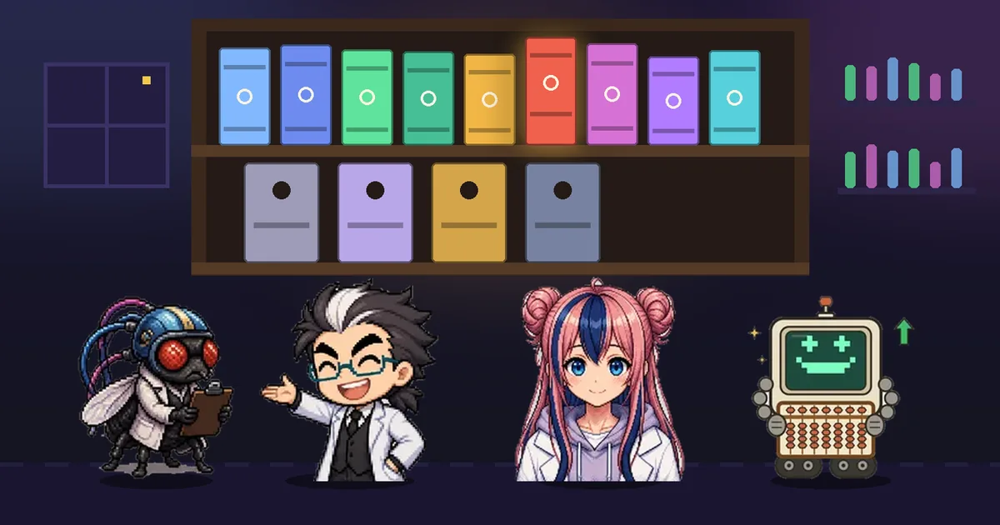

# 생성형 AI 활용 전략 — AI 연구실 해설

강의 **「생성형 AI 활용 전략」** 교안을 장마다 하나의 인터랙티브 해설 페이지로 옮긴 시리즈입니다.
박사 · 조수(하루) · 초파리 연구원 · 주판봇 네 연구실 식구가 진행하고, **AI를 처음 접하는 비전공자**도 끝까지 읽을 수 있게 썼습니다.

글 · 안상선 ([소개](https://adminmrobo.github.io/who_am_i/who_am_i.html)) · (주)M-Robo 대표



- **바로 보기:** <https://adminmrobo.github.io/generative-ai-prompt-strategy/> (GitHub Pages를 켠 뒤)
- **구조:** 목차(`index.html`)로 들어와 장을 고르면 해설 페이지로 이동하고, 각 페이지 맨 위 **← 목차**로 돌아옵니다.

## 목차

본문 9장과 부록 3~4편으로 구성할 예정입니다.

| 구분 | 페이지 | 상태 |
|---|---|---|
| 제1장 | — | 준비 중 |
| 제2장 | — | 준비 중 |
| 제3장 | — | 준비 중 |
| 제4장 | — | 준비 중 |
| 제5장 | — | 준비 중 ([이전 판](https://github.com/adminmrobo/Gen_AI_strategy_ch05)) |
| **제6장** | [프롬프트로 창업하기 — 카페와 쇼핑몰에 일을 맡기는 8요소 프레임워크](06_prompt_startup.html) | **공개** |
| **제7장** | [캐릭터를 설계도로 그리기 — 같은 얼굴을 다섯 장면 지키는 프롬프트](07_character_prompt.html) | **공개** |
| 제8장 | — | 준비 중 |
| 제9장 | — | 준비 중 |
| 부록 A | — | 준비 중 |
| 부록 B | — | 준비 중 |
| 부록 C | — | 준비 중 |
| 부록 D | — | 예정 |

### 제6장 페이지 구성

- **처음 오신 분께 — 3줄 요약:** 무엇을 / 왜 중요한가 / 업무에서는, 그리고 영어 약어 풀이(여덟 요소 머리글자 + 본문에 나오는 약어)
- **사다리 다섯 칸:** ① 한 줄 질문 → ② 역할·목표 → ③ 정책·대상·말투·지식 → ④ 형식·제약 → ⑤ 고급 기법. 칸마다 연구실 식구들의 대화가 어떤 버튼을 눌러 볼지 알려 줍니다.
- **왜 이 방법을 쓰나 + 조수의 수식 질문:** 숫자가 나오는 네 칸(①③④⑤)에서 문제 상황 → 앞 방법의 한계 → 이 방법, 그리고 수학을 어려워하는 조수가 묻고 학교 수학(일차함수 · 정비례 · 일차부등식 · 가중평균)과 숫자 예시로 풉니다.
- **대결:** 카페 창업 계획을 한 줄 프롬프트(초파리 연구원)로 쓸까, 8요소 프롬프트(주판봇)로 쓸까. 말하지 않은 요구 조건 8개의 적중률로 판정합니다(시드 고정 100회).
- **확인 퀴즈 12문항**, **지식 색인**(개념 83개 · 관계 129개)과 내려받기 꾸러미(JSON · JSON-LD · Turtle · CSV · BibTeX · RIS)

> 실험은 모두 **설명용 모형**이며 실제 AI를 부르지 않습니다. 네이밍 점수(예제 6-18), 가격 추천가(예제 6-17), 세그먼트 체류 시간(예제 6-03)은 교안의 예시값이고, 나머지 숫자는 설명용으로 정한 값입니다.

### 제7장 페이지 구성

- **처음 오신 분께 — 3줄 요약**과 영어 약어 풀이(POV · R-T-S-C · LOD · PBR · JSON · PR · K)
- **사다리 다섯 칸:** ① 설계도(6요소: 주제·표현·구도·조명·배경·제약) → ② 카메라(시점·앵글·9가지 샷) → ③ 숫자로 다듬기(표정 손잡이 %·3점 조명) → ④ 마스코트와 움직임(R-T-S-C·스틱맨 루프) → ⑤ 자산과 기록(사양서·파일 이름·GitHub)
- **왜 이 방법을 쓰나 + 조수의 수식 질문:** 다섯 칸 모두. 학교 수학(거듭제곱 · 반비례 · 정비례 · 내분(일차함수) · 곱의 법칙)과 숫자 예시로 풉니다.
- **실험 8종:** 6요소 조립기, 카메라 높이 실험, 아홉 가지 샷, 표정 손잡이, 3점 조명, R-T-S-C 카드, 스틱맨 루프, 파일 이름·버전 정렬·형식 검사
- **대결:** 다섯 장면 동안 외형을 더 잘 지키는 쪽 — 고정 블록 + 한 칸 수정(초파리 연구원) vs 매 장면 새로 쓰기(주판봇). 기준 시트 일치율로 판정합니다(설명용 모형, 시드 고정).
- **확인 퀴즈 10문항**, **지식 색인**(개념 48개 · 관계 65개)과 내려받기 꾸러미
- **원자료와 바꾼 곳:** 로우·하이앵글의 부위 설명을 "카메라에 가까운 쪽이 크게 보인다"로 통일, 조명비 "1:1.5"를 주광 100 : 보조광 60(약 1.7 : 1)으로 바로잡음

> 제7장의 숫자는 교안 프롬프트 예제의 값(미소 8%, 5500K, 주광 100%·보조광 60%·역광 30% 등)을 빼면 모두 설명용으로 정한 값입니다.

## 폴더 구조

```
.
├── index.html                    # 시리즈 목차 (표지) — 여기서 각 장으로 이동
├── 06_prompt_startup.html        # 제6장 해설 (단일 파일: 그림·캐릭터·데이터 포함)
├── 07_character_prompt.html      # 제7장 해설 (단일 파일)
├── assets/
│   ├── cover_index.webp          # 목차 표지 1600×900
│   ├── cover_index_960.webp      # 목차 표지 960×540
│   ├── og_index.webp             # 목차 공유 미리보기 1200×630
│   ├── thumb_06.webp             # 제6장 목차 카드 600×400
│   ├── og_06.webp                # 제6장 공유 미리보기 1200×630
│   ├── cover_07.webp             # 제7장 표지 1600×900 (페이지 안에도 들어 있음)
│   ├── thumb_07.webp             # 제7장 목차 카드 600×400
│   └── og_07.webp                # 제7장 공유 미리보기 1200×630
├── docs/
│   ├── KG_00_registry.json       # 시리즈 지식 그래프 ID 등록부
│   ├── ch06/
│       ├── IMG_06_prompt_startup.md    # 이미지 명세서
│       ├── COVER_06_prompt_startup.md  # 표지 생성 지시문
│   │   └── plain_data.py               # 비전공자용 문구(3줄 요약·약어·조수 질문·칸 대화)
│   └── ch07/
│       ├── IMG_07_character_prompt.md    # 이미지 명세서
│       └── COVER_07_character_prompt.md  # 표지 생성 지시문
├── .nojekyll
└── README.md
```

해설 페이지는 **파일 하나로 완결**됩니다. 내려받아 더블클릭만 해도 열리고, 인터넷이 없으면 웹 글꼴만 시스템 글꼴로 바뀝니다.

## GitHub Pages로 공개하기

1. 저장소 **Settings → Pages**에서 *Source*를 `Deploy from a branch`, 브랜치를 `main`, 폴더를 `/ (root)`로 정합니다.
2. 잠시 뒤 <https://adminmrobo.github.io/generative-ai-prompt-strategy/>에서 목차가 열립니다.
3. SNS 공유 미리보기를 쓰려면 `index.html`과 각 장 HTML의 `og:image`를 전체 주소로 바꿉니다.
   예: `https://adminmrobo.github.io/generative-ai-prompt-strategy/assets/og_index.webp`

## 새 장·부록 추가하기

1. 해설 페이지를 `NN_slug.html`(장) 또는 `AX_slug.html`(부록, 예: `AA_glossary.html`) 이름으로 루트에 올립니다.
2. 목차 카드 그림 `assets/thumb_NN.webp`(600×400)와 공유 그림 `assets/og_NN.webp`(1200×630)를 올립니다.
3. `index.html`에서 그 장의 `<!-- 제N장 -->` 카드를 6장 카드처럼 `<a class="card" href="NN_slug.html">`로 바꾸고 제목·설명·태그를 채웁니다. 장 번호는 목차 카드와 각 페이지 표지 칩에만 적습니다.
4. 이 README의 목차 표 한 줄을 바꿉니다.
5. `docs/chNN/`에 그 장의 이미지 명세서·표지 지시문을 넣고, 새 개념 ID를 `docs/KG_00_registry.json`에 합칩니다.
6. 각 장 페이지 맨 위 로고와 바닥글에 `index.html`로 돌아가는 링크를 넣습니다.

## 그림 상태

- 목차 표지와 제6·7장 표지는 캐릭터 팩 그림으로 만든 **임시 표지**입니다. 제7장 정식 표지 지시문은 `docs/ch07/COVER_07_character_prompt.md`에 있습니다. 주판봇이 나오는 정식 표지는 `docs/ch06/COVER_06_prompt_startup.md` 지시문으로 생성해 바꿀 예정입니다.

## 출처와 인용

- 원자료: 강의 「생성형 AI 활용 전략」 교안 (제6장 프롬프트 엔지니어링 활용 — 창업 프로세스 실습: 카페·패션 쇼핑몰 / 제7장 캐릭터 디자인을 위한 프롬프트)
- 인용 예: 안상선 (2026). 프롬프트로 창업하기 — 카페와 쇼핑몰에 일을 맡기는 8요소 프레임워크. AI 연구실 해설 대시보드 · 생성형 AI 활용 전략, v1.1.
- 인용 예(제7장): 안상선 (2026). 캐릭터를 설계도로 그리기 — 같은 얼굴을 다섯 장면 지키는 프롬프트. AI 연구실 해설 대시보드 · 생성형 AI 활용 전략, v1.0.
- 고급 기법의 문헌(제6장): ReAct (Yao 외, ICLR 2023), Self-Consistency (Wang 외, ICLR 2023), RAG (Lewis 외, NeurIPS 2020), Tree of Thoughts (Yao 외, NeurIPS 2023), Least-to-Most (Zhou 외, ICLR 2023), Reflexion (Shinn 외, 2023). DOI·쪽수는 확인 전입니다.

## 크레딧

- 캐릭터: [adminmrobo/fruitfly-lab-expressions](https://github.com/adminmrobo/fruitfly-lab-expressions) (캐릭터 팩 v1.1, 주판봇 포함)
- 제작 도구: [adminmrobo/ahnboat_lab_explainer](https://github.com/adminmrobo/ahnboat_lab_explainer) — ai-lab-explainer · ai-lab-extend 스킬
- 글꼴: IBM Plex Sans KR (Google Fonts, SIL Open Font License)

## 라이선스

<!-- 라이선스를 정하면 여기에 적고 LICENSE 파일을 추가하세요. -->
아직 정하지 않았습니다. 정해지기 전까지 모든 권리는 저자에게 있습니다. 네 캐릭터의 권리는 캐릭터 저장소의 안내를 따릅니다.
